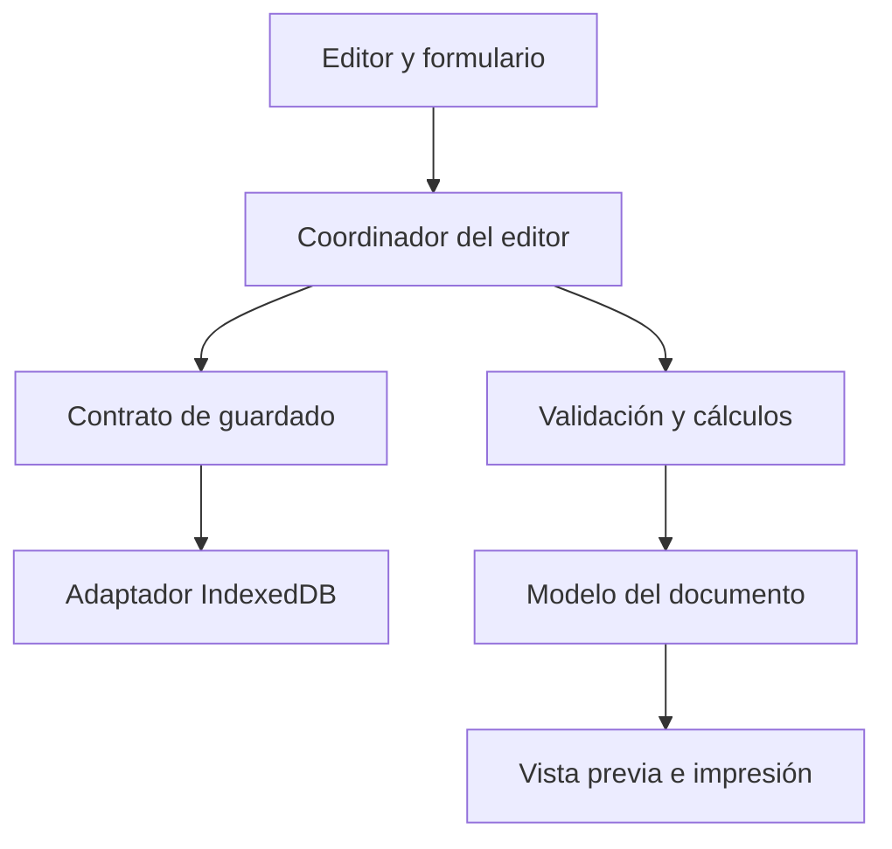

# Presupuestador: arquitectura y plan de construcción

Versión 1.1 · 17 de septiembre de 2026 · Proyecto de portfolio de Danilo

Documento de diseño original. Consulta `docs/estado.md` para conocer la implementación y sus verificaciones actuales.

## 1. Objetivo y alcance

Crear, editar, guardar y presentar presupuestos de servicios profesionales. El usuario debe poder recuperar su trabajo al recargar, conservar los precios históricos y distinguir pagos únicos de cuotas mensuales.

La primera versión será una aplicación Angular de uso individual con datos guardados en el navegador. Trabajará en euros, con precios introducidos sin IVA, descuentos por línea y dos periodicidades: pago único y mensual. Tendrá listado de presupuestos, editor con vista previa y configuración con catálogo de servicios.

El documento aportado sirve de referencia funcional y de cálculo. La demo pública utilizará datos ficticios de empresa, cliente y cuenta bancaria. Los importes de prueba pueden reproducirse sin incluir datos identificativos reales.

El inicio de sesión, la sincronización entre dispositivos, las retenciones, otras monedas y el envío de correos corresponden a ampliaciones posteriores. Exportar un presupuesto no ejecuta cobros ni envía mensajes. El producto genera presupuestos; convertirlo en sistema de facturación requiere un alcance propio.

## 2. Decisiones técnicas

| Área | Decisión | Motivo |
|---|---|---|
| Aplicación | Angular, componentes standalone y TypeScript estricto | Practicar el stack elegido y detectar errores de tipos. |
| Organización | Funcionalidades de presupuestos y configuración | Mantener juntos los archivos de cada tarea. |
| Formularios | Reactive Forms tipados; FormArray para líneas | Gestionar conceptos dinámicos y validación. |
| Estado | Un coordinador del editor; signals para estado y valores derivados | Hacer explícitos carga, guardado, errores y resumen. |
| Cálculos | Funciones puras de TypeScript con decimal.js | Separar aritmética de Angular y controlar el redondeo. |
| Persistencia | IndexedDB detrás de un repositorio asíncrono | Guardar documentos estructurados y preparar una futura API. |
| Estilos | SCSS y variables de diseño | Controlar el editor, la adaptación móvil y la impresión. |
| Documento | HTML semántico, CSS de impresión y diálogo del navegador | Conservar texto seleccionable y comenzar con una salida sencilla. |
| Pruebas | Motor de cálculo, persistencia y recorrido de edición | Verificar los comportamientos que pueden perder datos o alterar importes. |

Angular recomienda agrupar por funcionalidades y mantener las reglas independientes de la presentación. Su documentación describe los formularios reactivos y signals usados en esta propuesta: [organización](https://angular.dev/style-guide), [formularios](https://angular.dev/guide/forms/reactive-forms) y [signals](https://angular.dev/guide/signals).

IndexedDB admite datos estructurados y operaciones asíncronas. Se elige para el guardado local de presupuestos y configuración. Véase [MDN: IndexedDB](https://developer.mozilla.org/en-US/docs/Web/API/IndexedDB_API). Los importes se operarán con la [API de decimal.js](https://mikemcl.github.io/decimal.js/).

Para este arranque se utilizará **Angular 21.2**, creando el proyecto con **Angular CLI 21.2.19**, y **npm** como gestor. La captura del entorno Windows muestra Node **24.13.0**, npm **11.6.2**, Git **2.52.0.windows.1** y CLI **21.2.19**; son versiones observadas, no una prueba de compilación del proyecto.

Node 24.13.0 cumple el rango de Angular 21.2 (`^24.0.0`). No cumple el mínimo de la rama 24 para Angular 22 (`^24.15.0`); se sustituye la propuesta previa de Angular 22 por Angular 21.2 para comenzar con el entorno disponible. Véase la [tabla oficial de compatibilidad](https://angular.dev/reference/versions).

La CLI de la captura selecciona Bun; al generar esta aplicación se especificará `--package-manager=npm`. Se conservará `package-lock.json` en Git y se usarán las versiones locales del proyecto. La resolución inicial debe quedar dentro de Angular 21.2 y registrarse en `docs/estado.md`. No se modifica la configuración global de otros proyectos.

## 3. Responsabilidades y dependencias



Las flechas muestran el recorrido del trabajo. En el código, el coordinador conoce el contrato de guardado y recibe una implementación por inyección; el contrato no importa IndexedDB. El motor de cálculo no importa Angular, el navegador ni el repositorio.

| Pieza | Responsabilidad |
|---|---|
| Componentes | Mostrar campos, mensajes y resultados; emitir las acciones del usuario. |
| Formulario | Mantener los valores editables y sus validaciones de entrada. |
| Coordinador del editor | Abrir presupuestos, observar cambios, calcular, guardar y publicar estados de la interfaz. |
| Motor de cálculo | Recibir datos válidos y devolver bases, descuentos, impuestos y totales. |
| Repositorio | Leer y escribir documentos; comprobar revisiones para evitar sobrescrituras. |
| Constructor del documento | Preparar secciones y datos de presentación a partir del presupuesto y sus cálculos. |
| Componente de documento | Representar el mismo contenido en vista previa e impresión. |

El formulario será la única fuente editable mientras el editor esté abierto. Los signals del resumen serán derivados de sus cambios; no habrá una segunda copia editable que compita con él. Cargar un documento rellenará el formulario sin disparar un guardado de valores iniciales vacíos.

## 4. Estructura de archivos propuesta

Las rutas siguientes son relativas al futuro repositorio `presupuestador`. Se crearán conforme se implemente cada funcionalidad.

| Ruta | Contenido |
|---|---|
| `src/app/app.config.ts` | Proveedores e implementación activa de los repositorios. |
| `src/app/app.routes.ts` | Rutas y carga de pantallas. |
| `src/app/shell/` | Navegación y estructura visual común. |
| `src/app/features/quotes/quote-list/` | Listado, búsqueda, duplicación y estados. |
| `src/app/features/quotes/quote-editor/` | Editor, formulario y controles de servicios. |
| `src/app/features/quotes/quote-editor/quote-editor-store.ts` | Coordinación de carga, cálculo y guardado. |
| `src/app/features/quotes/quote-editor/quote-form.ts` | Creación de formularios tipados y conversión de valores. |
| `src/app/features/quotes/quote-preview/` | Pantalla de vista previa. |
| `src/app/features/quotes/quote-document/` | Documento reutilizado en pantalla e impresión. |
| `src/app/features/quotes/quote-repository.ts` | Contrato asíncrono de persistencia e identificador de inyección. |
| `src/app/features/quotes/indexeddb-quote-repository.ts` | Implementación local del contrato. |
| `src/app/features/settings/` | Empresa, marca, métodos de pago y catálogo. |
| `src/app/domain/quotes/quote.ts` | Presupuesto, cliente, emisor y condiciones capturadas. |
| `src/app/domain/quotes/quote-line.ts` | Conceptos, periodicidad, descuentos e impuestos. |
| `src/app/domain/quotes/calculate-quote.ts` | Cálculo puro y política de redondeo. |
| `src/app/domain/quotes/validate-quote.ts` | Validaciones para calcular y producir un documento completo. |
| `src/app/domain/quotes/quote-totals.ts` | Resultados del cálculo y agrupaciones. |
| `src/app/core/persistence/app-database.ts` | Apertura y actualización de la base IndexedDB. |
| `src/app/core/backup/` | Exportación e importación versionadas. |
| `src/app/shared/ui/` | Elementos visuales que realmente se reutilicen. |
| `src/styles.scss` | Variables visuales y estilos globales. |
| `docs/arquitectura.md` | Este documento y las decisiones que se revisen. |

Los archivos de pruebas estarán junto al código que comprueban. El código y los nombres de tipos se escribirán en inglés; la interfaz, los mensajes y la documentación para el usuario, en español.

## 5. Pantallas y rutas

| Ruta | Función |
|---|---|
| `/presupuestos` | Listar, filtrar, duplicar y eliminar presupuestos con confirmación. |
| `/presupuestos/nuevo` | Crear un borrador y obtener un identificador persistente. |
| `/presupuestos/:id/editar` | Editar el documento y ver el resumen actualizado. |
| `/presupuestos/:id/vista-previa` | Revisar el documento y abrir el diálogo de impresión. |
| `/configuracion` | Editar empresa, logo, catálogo, valores predeterminados y copias de seguridad. |

La configuración puede organizarse en pestañas. Los datos del cliente se capturan dentro de cada presupuesto; una agenda independiente de clientes podrá añadirse más adelante.

## 6. Modelo de datos

| Modelo | Datos principales |
|---|---|
| `AppSettings` | Emisor predeterminado, marca, catálogo, IVA sugerido, condiciones y formato de numeración. |
| `ServiceTemplate` | Identificador, nombre, descripción, unidad, precio, periodicidad e impuesto sugeridos. |
| `Quote` | Identificador técnico, número visible, fechas, estado, copias de emisor y cliente, líneas, condiciones, versiones y fechas de guardado. |
| `QuoteLine` | Identificador estable, referencia opcional al catálogo, nombre, descripción, unidad, cantidad, precio, descuento, impuesto y periodicidad. |
| `QuoteTotals` | Resultados por línea, grupos de impuestos, cuota mensual, pago único y resumen conjunto. |

Reglas de modelado:

- El identificador interno será un UUID. El número visible, como `P-2026-0001`, se almacena por separado y puede editarse. No se deduce la fecha de emisión de un número importado.
- Se valida la unicidad del número dentro de la base local. Esta garantía no abarca otros dispositivos.
- Las fechas de emisión y validez son cadenas `YYYY-MM-DD`; los instantes técnicos, como `updatedAt`, usan ISO con zona horaria.
- Los valores decimales se serializan como cadenas canónicas: `"150.00"`, `"2.5"` o `"21"`. El formato español se aplica al mostrar y se normaliza al introducir datos.
- El borrador puede contener campos incompletos. Se guarda sin convertir silenciosamente un campo vacío en cero. El cálculo indica qué falta y la salida definitiva exige datos válidos.
- Cantidad, unidad y nombre del servicio se mantienen separados. Cambiar de ocho a diez sitios actualiza la presentación sin dejar una descripción automática obsoleta.
- El orden se conserva mediante el orden del array de líneas. Cada línea conserva su UUID aunque se mueva.

Ejemplo de tipos centrales, a desarrollar al implementar:

```ts
type BillingFrequency = 'one-time' | 'monthly';
type QuoteStatus = 'draft' | 'sent' | 'accepted' | 'rejected';
type DecimalText = string; // Requiere validación en tiempo de ejecución.

type Discount =
  | { kind: 'none' }
  | { kind: 'percentage'; value: DecimalText }
  | { kind: 'fixed'; value: DecimalText };

type Vat =
  | { kind: 'taxed'; rate: DecimalText }
  | { kind: 'exempt'; note: string }
  | { kind: 'not-subject'; note: string };

interface QuoteLine {
  id: string;
  sourceServiceId?: string;
  name: string;
  description: string;
  unit: string;
  quantity: DecimalText;
  unitPrice: DecimalText;
  frequency: BillingFrequency;
  discount: Discount;
  vat: Vat;
}
```

La aplicación permite seleccionar y describir el tratamiento fiscal; no lo decide automáticamente a partir del cliente o del nombre del servicio. Un tipo del 0 % y una operación exenta se representan de forma distinta. La primera versión no calcula retenciones ni situaciones fiscales especiales.

## 7. Copias históricas y estados

Al añadir un servicio, se copian sus datos dentro del presupuesto. `sourceServiceId` sirve para identificar su origen; no provoca actualizaciones de precio o descripción en documentos existentes.

También se copian emisor, cliente, instrucciones de pago, condiciones y marca. Cambiar un IBAN o logo en configuración afecta a futuros presupuestos. Para simplificar copias de seguridad, cada documento puede conservar una imagen pequeña de su logo como data URL validada de PNG, JPEG o WebP, con un límite propuesto de 300 KiB de imagen original. No se aceptan HTML ni SVG arbitrarios como logo.

Los borradores son editables. Al marcar uno como enviado se validan sus datos y se conservan sus totales calculados con `calculationVersion`. Enviado, aceptado y rechazado mantienen el contenido de esa versión; se puede modificar su estado comercial, pero para cambiar servicios o importes se crea una nueva revisión en borrador. La acción «marcar como enviado» es manual y no envía un correo.

Una duplicación crea un nuevo UUID, número y fechas. Una revisión puede añadir `revisionOfId` para enlazar al documento anterior. Ambas conservan una copia independiente de los datos.

## 8. Motor de cálculo

Una función `calculateQuote()` devolverá un resultado válido o una lista de errores identificados por campo y línea. Se utilizará en el resumen y al preparar el documento. Su versión inicial será `calculationVersion: 1`.

Convención de cálculo del producto en euros:

1. Multiplicar cantidad por precio sin IVA y redondear el bruto de la línea a dos decimales.
2. Calcular el descuento sobre ese bruto. Un descuento fijo corresponde al conjunto de la línea, no a cada unidad.
3. Redondear el descuento a dos decimales y restarlo del bruto.
4. Aplicar el porcentaje de IVA a la base resultante y redondear la cuota a dos decimales.
5. Sumar base e IVA para obtener el total de la línea.
6. Sumar los valores de las líneas ya calculadas para obtener subtotales y totales.

Se utilizará redondeo decimal `ROUND_HALF_UP`. La precisión interna de decimal.js se configurará explícitamente, junto con límites de entrada; no se realizarán operaciones monetarias intermedias con `number`. Estos son criterios técnicos de esta aplicación, no una afirmación de que exista una única convención universal para todos los programas de facturación.

Se agrupa por periodicidad y por tratamiento/tipo de IVA. La cuota de cada grupo es la suma de las cuotas de sus líneas; no se recalcula con otro método al exportar. La entrada permite cantidades positivas con hasta tres decimales y precios en euros con hasta dos. Los descuentos porcentuales van de 0 a 100; los fijos no pueden superar el bruto. Se rechazan importes negativos, valores no finitos y entradas ambiguas.

Con varias periodicidades, se presenta «Pago único» y «Cuota mensual». El importe combinado sólo se etiqueta «Pago inicial» cuando el usuario indica que incluye una mensualidad. No se calcula un coste contractual total sin duración acordada.

Caso de referencia:

| Grupo | Base | IVA | Total |
|---|---:|---:|---:|
| Mensual: 8 × 150 + 130 | 1.330,00 € | 279,30 € | 1.609,30 € |
| Único: 1 × 195 | 195,00 € | 40,95 € | 235,95 € |
| Conjunto de esos conceptos | 1.525,00 € | 320,25 € | 1.845,25 € |

## 9. Persistencia, autoguardado y recuperación

IndexedDB tendrá dos almacenes iniciales: `quotes` y `settings`. El esquema físico tendrá su propia versión. Cada documento incluirá `schemaVersion`, `calculationVersion` y `revision`; son conceptos diferentes.

El repositorio expondrá operaciones asíncronas para listar, buscar por ID, crear, guardar y eliminar. Un guardado recibirá la revisión esperada y devolverá la revisión guardada; si el documento cambió en otra pestaña, devolverá un conflicto. Angular resolverá la implementación mediante un `InjectionToken`, ya que las interfaces TypeScript no existen en ejecución. Véase [proveedores de dependencias](https://angular.dev/guide/di/defining-dependency-providers).

Flujo de guardado:

1. Cargar el documento antes de habilitar el autoguardado.
2. Conservar el borrador en memoria con cada cambio y recalcular cuando sus campos numéricos sean válidos.
3. Aplicar un debounce de 500 ms y guardar una copia completa del borrador mediante una transacción.
4. Serializar las escrituras para que una operación antigua no sobrescriba una más nueva. Identificar las ediciones pendientes para no mostrar «Guardado» mientras falten cambios por escribir.
5. Mostrar «Sin guardar», «Guardando», «Guardado a las…» o un error real. El éxito se comunica al completar la transacción.
6. Al navegar dentro de la aplicación, completar el guardado pendiente; si falla, conservar el editor y ofrecer exportar la copia en memoria. Ante una recarga/cierre inmediato con cambios pendientes, advertir cuando el navegador lo permita; no prometer una escritura asíncrona garantizada durante el cierre.

Los datos pertenecen al navegador, perfil y origen usados. No se sincronizan entre dispositivos y pueden perderse al borrar datos del sitio. La exportación JSON versionada es la copia de seguridad de esta versión.

Al importar, se validan versión, estructura, tamaños, tipos, decimales e identificadores. Se muestra un resumen antes de aplicar cambios y se resuelven colisiones explícitamente. La operación será transaccional y no borrará documentos que no estén en la copia. Un borrador incompleto legítimo puede restaurarse; una estructura dañada no se acepta.

## 10. Vista previa e impresión

Un único componente de documento recibirá el modelo de presentación. El editor lo muestra en vista previa y la ruta imprimible lo utiliza con CSS A4. El documento debe usar texto real, permitir descripciones extensas y mantener visibles bases, tipos de IVA, periodicidades y condiciones.

La primera exportación abre el diálogo del navegador, donde se puede imprimir o guardar como PDF. No se presentará como una descarga directa silenciosa. El usuario podrá desactivar las cabeceras y pies añadidos por el navegador. La compatibilidad de paginación, repeticiones y numeración se verificará en los navegadores objetivo antes de prometer una reproducción exacta del PDF de referencia. Véase [CSS de impresión](https://developer.mozilla.org/en-US/docs/Web/CSS/Guides/Media_queries/Printing).

Se evitarán cortes entre el nombre del concepto y las primeras líneas de su descripción. Las descripciones que excedan una página deben poder continuar. Se probará un presupuesto breve y otro de varias páginas.

## 11. Pruebas que definen la primera versión

| Caso | Resultado esperado |
|---|---|
| Tres conceptos de referencia, IVA 21 % | Base 1.525,00; IVA 320,25; total 1.845,25. |
| Separación de periodicidades | Mensual 1.609,30; único 235,95. |
| Una línea de 100 con descuento 10 % e IVA 21 % | Base 90,00; IVA 18,90; total 108,90. |
| Tres unidades de 0,10 con IVA 21 % | Base 0,30; IVA 0,06; total 0,36. |
| 2,5 horas a 40 con IVA 21 % | Base 100,00; IVA 21,00; total 121,00. |
| Bases de 100 al 21 % y 50 al 10 % | Dos grupos fiscales; total 176,00. |
| Descuento fijo superior al bruto | Error de validación; no total definitivo. |
| Vaciar temporalmente un precio | Borrador conservado; cálculo pendiente y error visible. |
| Cambiar un precio del catálogo | Presupuesto anterior intacto. |
| Recargar después de «Guardado» | Misma empresa, cliente, líneas, orden, notas y logo. |
| Fallar una escritura | Error visible y borrador conservado en memoria. |
| Guardar desde dos pestañas con la misma revisión | Una escritura posterior detecta el conflicto. |
| Vista previa e impresión | Mismos importes y datos del mismo documento. |
| Exportar e importar una copia | Conservación de documentos; colisiones resueltas explícitamente. |

Estas pruebas protegen importes y datos. No hace falta cubrir inicialmente cada componente meramente visual con pruebas unitarias.

## 12. Orden de construcción

| Entrega | Trabajo | Criterio para terminar |
|---|---|---|
| 1. Base y cálculos | Crear proyecto, rutas vacías, modelos y calculadora con datos ficticios. | Compila y reproduce los importes de referencia y los casos de descuento/decimales. |
| 2. Editor | Formularios de emisor, cliente, servicios y condiciones; resumen por periodicidad. | Añadir, editar, duplicar, ordenar y eliminar líneas actualiza los resultados. |
| 3. Guardado | Repositorio, IndexedDB, estados, errores y autoguardado. | Recupera el documento completo tras recargar después del guardado. |
| 4. Gestión | Listado, catálogo, configuración, numeración, copias históricas y revisiones. | Crear desde catálogo y actualizarlo no modifica presupuestos previos. |
| 5. Documento y entrega | Vista imprimible, paginación, copia JSON, demo y README. | Completar, recuperar, revisar y guardar un presupuesto como PDF funciona de principio a fin. |

El primer trabajo de código será el modelo y `calculate-quote.ts` con sus pruebas. Se conectará después al editor. Así cualquier error aritmético puede localizarse antes de introducir formularios y persistencia.

## 13. Evolución a Spring Boot

Cuando la primera versión funcione, se podrá añadir un adaptador HTTP al contrato del repositorio y una API Spring Boot con MySQL. Será necesario implementar acceso de usuarios, autorización sobre cada presupuesto, validación, control de revisiones y migración/importación de los datos locales.

El servidor calculará y validará los importes con `BigDecimal`; será la autoridad al guardar o cerrar presupuestos. El cálculo en Angular seguirá proporcionando una respuesta inmediata al editar. Se compartirán casos de prueba y una especificación de redondeo para mantener ambos resultados equivalentes. El código TypeScript de la calculadora no se reutiliza directamente como código Java.

Esta separación reduce los cambios en componentes y formularios cuando llegue el backend. No significa que añadir usuarios, sincronización y servidor sea un cambio de una sola línea. Hasta entonces, el repositorio local será la única fuente persistente de la aplicación.

